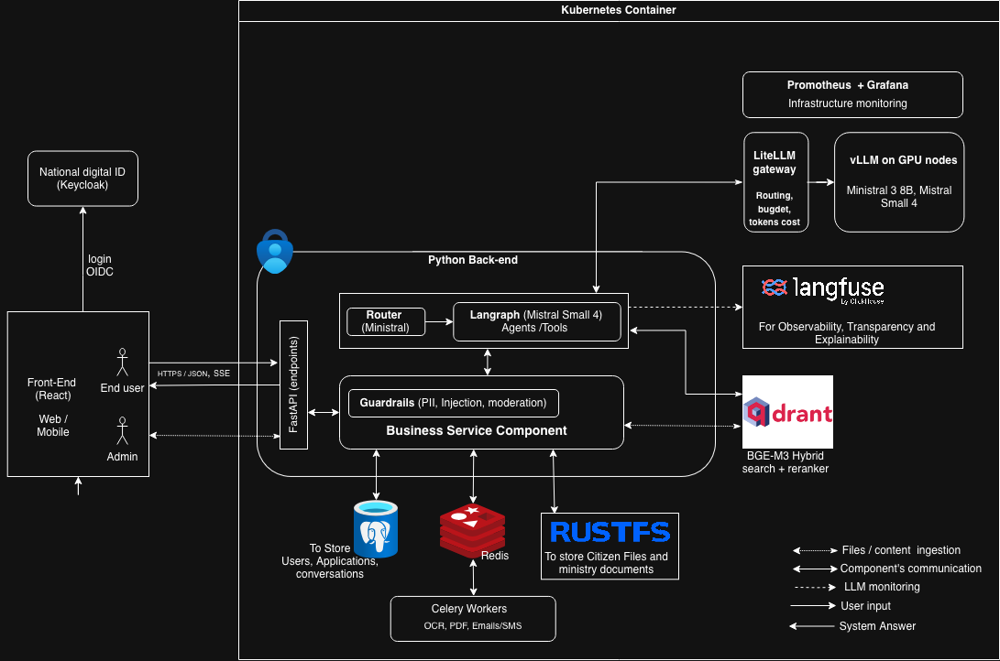

# Technical Assessment

## Main file

The main deliverables for the assessment are:

- `task_1_and_task_2.ipynb`
- `deliverable.pf`

## Create the local environment (.venv)

From the project root, run:

```bash
python3 -m venv .venv
source .venv/bin/activate
python -m pip install --upgrade pip
```

## Install packages

With the environment activated:

```bash
python -m pip install -r requirements.txt
```

To quickly verify a few important dependencies:

```bash
python -m pip show geojson pyproj shapely ipykernel
```

## Data

Input data is located in:

- `data/`

Important: before running any test or notebook cell, make sure the `data/` folder is present at the project root. This folder is not pushed to the repository.

## Figures

Figures generated for the analysis are in:

- `figures/`

## Task 3 architecture

The Task 3 architecture diagram is stored at the project root with the filename:

- `Task_3_Architecture.png`



## Prompt history

The table below summarizes prompts used during the work and how their outputs were applied in the notebook.

| #   | Prompt                                              | Objective                                                                                                                                                                  | How prompt output was used in this project                                                                                                             |
| --- | --------------------------------------------------- | -------------------------------------------------------------------------------------------------------------------------------------------------------------------------- | ------------------------------------------------------------------------------------------------------------------------------------------------------ |
| 1   | `MODIS preprocessing (scale, invalid values, time)` | Build a robust MODIS NDVI/EVI preprocessing pipeline from NetCDF (scale_factor/add_offset, fill-value masking, safe time decoding, and validation checks).                 | I adapted the suggested steps into the MODIS loading section: metadata-driven scaling, fill-value masking, and safe time decoding with fallback logic. |
| 2   | `Geospatial zonal statistics by polygon`            | Create a generic workflow to compute polygon-level NDVI/EVI statistics (mean, min, max) over time with quality checks for mask alignment and missing pixels.               | I implemented polygon masking and per-date NDVI/EVI summary statistics, then reviewed outputs for empty slices and geometry-to-grid consistency.       |
| 3   | `Long-to-wide reshape into 72 monthly features`     | Transform long vegetation-index data into a stable wide matrix with 72 monthly predictors and a fixed schema even when months are missing.                                 | I used the proposed reshape pattern (melt + pivot) and enforced a fixed 72-feature schema by creating missing monthly columns as NaN.                  |
| 4   | `Robust yield + VI feature merge`                   | Define robust merge logic between yield and vegetation features using country/admin/year keys, text normalization, duplicate handling, and unmatched-record diagnostics.   | I applied text normalization on join keys, aggregated duplicate yield rows, and added diagnostics for matched vs unmatched records after merge.        |
| 5   | `Reproducible modeling pipeline (Ridge + CV)`       | Build a reproducible scikit-learn pipeline with imputation, scaling, one-hot encoding, Ridge + cross-validation alpha tuning, and hold-out evaluation with leakage checks. | I implemented the full sklearn pipeline with fixed random seed, train/test split, CV-based alpha tuning, and separate hold-out evaluation.             |
| 6   | `Notebook debugging (variable collisions)`          | Diagnose x/y size mismatch caused by variable collisions in notebooks and apply robust naming and validation patterns to prevent silent reuse bugs.                        | I refactored plotting variables to use explicit admin2 test vectors and added checks to avoid silent reuse of overwritten variables across sections.   |

## AI usage compliance note

- AI was used for code suggestions, debugging support, and workflow structuring, not to replace end-to-end problem solving.
- No raw assessment data was shared with external AI tools.
- Prompt outputs were treated as draft guidance and then manually adapted to this notebook context.
- Final implementation choices, execution, and result validation were performed manually.
